<div align="center">


<br><br>


</div>

### 🌟 About me

```js
const kendalVR = {
  name:      "Kevin Daniel Lozano",
  location:  "Santa Cruz, Bolivia",
  role:      "XR Developer & On-Device AI",
  studying:  "Systems Engineering · Univalle",
  building:  "Sendero AR — offline AR for cultural heritage",
  shipped:   ["Walkback — NASA Space Apps 2026", "concilia — 100% local AI agent"],
  learning:  ["AWS", "Terraform"],
  motto:     "If it needs the cloud to work, it doesn't work offline."
};
```

<div align="center">



### 🛠️ Tech stack



### 📊 GitHub analytics





### 🤝 Let's connect

<a href="https://linkedin.com/in/danielvr-dev"></a>
<a href="https://instagram.com/kendalvr.dev"></a>
<a href="https://youtu.be/HYLDNIek2nM"></a>

<br><br>

<picture>
  <source media="(prefers-color-scheme: dark)" srcset="https://raw.githubusercontent.com/kendal-dev/kendal-dev/output/snake-dark.svg">
  
</picture>


</div>

<!-- README revisado: 2026-11-16 -->
